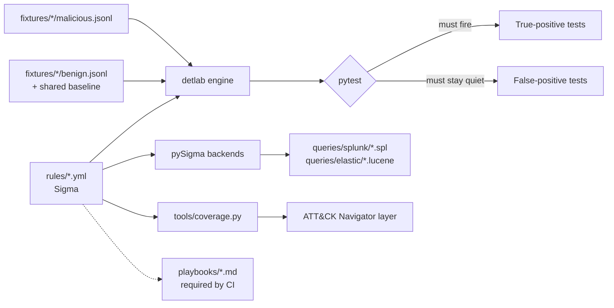

# Sigma Detection Lab

[](https://github.com/BombDiggity2454/sigma-detection-lab/actions/workflows/ci.yml)


**Windows threat detections written as code: tested against attack and
benign samples on every commit, mapped to MITRE ATT&CK, exported to Splunk
and Elastic, with a SOC triage playbook for every alert.**

```
$ python -m detlab scan samples/incident_ws-fin-07.jsonl
6 rules x 11 events -> 6 alert(s)

2026-11-02 14:03:11.512  [HIGH  ] PowerShell Launched With Encoded Command
2026-11-02 14:06:22.090  [HIGH  ] Certutil Used to Download a File
2026-11-02 14:09:52.311  [HIGH  ] Suspicious Process Opened LSASS With Memory-Read Access
2026-11-02 14:10:05.700  [MEDIUM] Run Key Persistence Pointing to Suspicious Path or Script Host
2026-11-02 14:12:30.000  [HIGH  ] Scheduled Task Created That Runs From a Suspicious Location
2026-11-02 14:15:41.000  [HIGH  ] Security Event Log Cleared
```

That sample is a simulated phishing intrusion on one workstation: a macro
document leads to encoded PowerShell, a certutil download, credential
dumping, two kinds of persistence, and log clearing. It is mixed with normal
activity, including Microsoft Defender legitimately scanning LSASS. Every
attack step alerts. None of the normal activity does.

---

## Why this repo exists

In many SOCs, detections are edited directly in the SIEM, with no tests,
no review, and no record of why a filter was added. When someone "tunes" a
rule, nobody can prove it still catches the attack. This repo treats
detections like software:

| Practice | How it's done here |
|---|---|
| **Version control & review** | Rules are YAML in Git. Changes go through pull requests. |
| **Tests for true positives** | Every rule has `malicious.jsonl` samples it **must** fire on. |
| **Tests for false positives** | Every rule has `benign.jsonl` *look-alike* samples it **must not** fire on, plus a shared baseline of normal activity. |
| **Analyst-ready** | Every rule ships with a triage playbook; CI fails if one is missing. |
| **SIEM-portable** | Rules are converted to Splunk SPL and Elastic Lucene with the reference [pySigma](https://github.com/SigmaHQ/pySigma) backends. |
| **Coverage visibility** | ATT&CK coverage table and Navigator heatmap are generated from rule tags. |

## Detections

| Technique | Rule | Level | Playbook |
|---|---|---|---|
| T1059.001 / T1027 | [PowerShell Launched With Encoded Command](rules/windows/process_creation/proc_creation_win_powershell_encoded_command.yml) | high | [triage](playbooks/proc_creation_win_powershell_encoded_command.md) |
| T1105 / T1218 | [Certutil Used to Download a File](rules/windows/process_creation/proc_creation_win_certutil_download.yml) | high | [triage](playbooks/proc_creation_win_certutil_download.md) |
| T1003.001 | [Suspicious Process Opened LSASS With Memory-Read Access](rules/windows/process_access/proc_access_win_lsass_memory_read.yml) | high | [triage](playbooks/proc_access_win_lsass_memory_read.md) |
| T1547.001 | [Run Key Persistence Pointing to Suspicious Path or Script Host](rules/windows/registry/registry_set_win_run_key_suspicious_path.yml) | medium | [triage](playbooks/registry_set_win_run_key_suspicious_path.md) |
| T1053.005 | [Scheduled Task Created That Runs From a Suspicious Location](rules/windows/security/win_security_scheduled_task_suspicious_location.yml) | high | [triage](playbooks/win_security_scheduled_task_suspicious_location.md) |
| T1070.001 | [Security Event Log Cleared](rules/windows/security/win_security_audit_log_cleared.yml) | high | [triage](playbooks/win_security_audit_log_cleared.md) |

Full generated table: [coverage/COVERAGE.md](coverage/COVERAGE.md) ·
Heatmap: load [coverage/attack-navigator-layer.json](coverage/attack-navigator-layer.json)
into the [ATT&CK Navigator](https://mitre-attack.github.io/attack-navigator/).

## How it works



**`detlab/`** is a small Sigma evaluator (one file, PyYAML only) that runs
rules directly against JSON events. It implements the Sigma subset these
rules use (field modifiers, wildcards, `windash`, `cidr`, `re`, and
`1 of` / `all of` conditions) and **raises an error on anything it doesn't
support**, so a rule can never pass a test just because a feature was
silently ignored. The engine has its own unit tests in
[`tests/test_engine.py`](tests/test_engine.py).

**Log source mapping.** Events carry their Windows `Channel` and `EventID`.
A rule for `category: process_access` therefore only sees Sysmon event 10,
not every event that happens to contain a `TargetImage` field.

## Quick start

```bash
git clone https://github.com/BombDiggity2454/sigma-detection-lab
cd sigma-detection-lab
python -m pip install -r requirements.txt

python -m pytest -v                                  # run every detection test
python -m detlab scan samples/incident_ws-fin-07.jsonl   # demo incident
python tools/convert.py                              # regenerate SIEM queries
python tools/coverage.py                             # regenerate ATT&CK coverage
```

`detlab scan` exits with code 1 when it raises alerts, so it can gate a pipeline.

## Adding a rule

1. Write `rules/windows/<category>/<name>.yml` (copy an existing rule; new UUID for `id`).
2. Add `tests/fixtures/<name>/malicious.jsonl`: the attack variants it must catch.
3. Add `tests/fixtures/<name>/benign.jsonl`: **realistic look-alikes** it must ignore.
4. Copy [`playbooks/_TEMPLATE.md`](playbooks/_TEMPLATE.md) to `playbooks/<name>.md` and fill it in.
5. Run `python -m pytest`, `python tools/convert.py`, and `python tools/coverage.py`, then commit.

CI fails if any step is skipped.

## Design decisions worth calling out

- **Filters use full paths, not process names.** The LSASS rule excludes
  `C:\ProgramData\Microsoft\Windows Defender\Platform\…\MsMpEng.exe`, not just
  `MsMpEng.exe`. The test fixtures include a credential dumper renamed to
  `MsMpEng.exe` in the wrong folder, and it still alerts.
- **`OriginalFileName` catches renamed binaries.** The PowerShell and
  certutil rules match on the PE header name as well as the file path, so
  copying `powershell.exe` to `update.exe` doesn't evade them.
- **Benign fixtures are adversarial, not filler.** For example,
  `-ExecutionPolicy` begins with `-e` but is not `-EncodedCommand`, ffmpeg
  takes an `-enc` flag, and a script named `backup-encrypt.ps1` contains
  `-enc`. Each of these protects against a specific false positive.

## Data

All sample events are **synthetic**, hand-written to match real Sysmon and
Windows Security field names. IPs come from the RFC 5737 documentation ranges
(`198.51.100.0/24`, `203.0.113.0/24`). No real malware or customer data is
included.

## Roadmap

- [ ] EVTX → JSONL converter and tests against public datasets ([OTRF Security-Datasets](https://github.com/OTRF/Security-Datasets), [EVTX-ATTACK-SAMPLES](https://github.com/sbousseaden/EVTX-ATTACK-SAMPLES))
- [ ] Threshold and correlation rules (brute force T1110: many 4625 events, then a 4624)
- [ ] Field mapping so `process_creation` rules also work on Security 4688
- [ ] More rules: PsExec-style service install (T1569.002), new local admin (T1136.001 + T1098), LOLBins (rundll32/mshta/regsvr32 making network connections), discovery bursts (T1087)
- [ ] Per-rule false-positive rate measured against a large benign corpus

## License

MIT. See [LICENSE](LICENSE).
